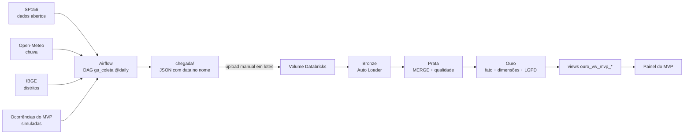

# Calçada Livre — Big Data Architecture & Data Integration · Global Solution 2026.2 · CitizenTech · FIAP ES 4º ano

Mapa vivo de barreiras de acessibilidade nas calçadas de São Paulo, alimentado por um carrinho inspetor, por fotos de cidadãos e por dados abertos.

## Integrantes
| Nome completo | RM |
|---|---|
| Carlos Ganzerli | 99840 |
| Paulo Lopes | 551137 |
| Lucas Bandeira | 98640 |
| Gustavo Melo Namura | 98809 |

## Ficha Técnica do MVP
| Campo | Conteúdo |
|---|---|
| **Nome do produto** | Calçada Livre |
| **Cidadão e território** | Pessoas com deficiência, idosos e mães com carrinho de bebê; calçadas do município de São Paulo (piloto em uma subprefeitura) |
| **Problema, em uma frase** | Pessoas com mobilidade reduzida deixam de sair de casa ou se machucam porque não sabem quais calçadas têm barreiras, e a prefeitura não tem um mapa atualizado delas |
| **Proposta de valor** | Um mapa único e atualizado de barreiras (obstáculos, buracos, degraus, trechos escuros), com triagem automática para a zeladoria e um assistente que explica direitos e normas em linguagem simples |
| **Arquitetura: componentes** | Carrinho inspetor (Maker Lab) · Foto do cidadão + detecção (Visão) · Assistente de dúvidas (GenAI) · Triagem automática (RPA) · Pipeline de dados (Big Data) · Mapa e painel (MVP) · Produção (DevOps) · Pitch (BI) |
| **Fontes de dados** | SP156 (pedidos de calçada, dados abertos da Prefeitura) · Open-Meteo (chuva) · IBGE (distritos) · ocorrências do próprio MVP (app, carrinho, visão) · leis federais de acessibilidade (planalto.gov.br) |
| **Modelos de IA utilizados** | Qwen2.5-1.5B-Instruct + LoRA com RAG (assistente) · multilingual-e5-small (busca) · YOLO nano (visão) · árvore de decisão embarcada (carrinho) |
| **URL do MVP e repositório** | URL: COLE_AQUI · Repositório: https://github.com/melo-zz/calcada-livre-bigdata |
| **Indicadores de impacto** | Barreiras mapeadas · % resolvidas em até 30 dias · dias até a resolução · km de rota acessível |
| **ODS conectados** | **ODS 11** (cidades inclusivas e acessíveis, metas 11.2 e 11.7) · **ODS 10** (redução das desigualdades) · **ODS 3** (saúde e bem-estar: menos quedas de idosos) |

### As seis perguntas do briefing
1. **Quem é o cidadão beneficiado?** Pessoas com mobilidade reduzida, idosos e responsáveis por crianças pequenas.
2. **Qual problema será resolvido?** Falta de informação confiável e atualizada sobre barreiras nas calçadas.
3. **Como a solução funcionará?** Toda barreira vira uma *ocorrência* na API central (tipo, local, foto, prioridade, status); RPA triagem e encaminha; Big Data cruza com chuva e demanda; o assistente explica direitos; o mapa mostra tudo.
4. **Quais tecnologias?** FastAPI, Postgres, Airflow, Databricks, LLM local com LoRA, YOLO, ESP32/Arduino, Docker, Terraform, GitHub Actions, Prometheus e Grafana.
5. **Quem participa do ecossistema?** Cidadãos, subprefeituras (zeladoria), concessionárias, shoppings, hospitais e campi (inspeção com o carrinho).
6. **Como medir e ampliar o impacto?** Indicadores acima; expansão por subprefeitura; receita por assinatura do painel de gestão.

**Perguntas que o MVP responde ao cidadão e à prefeitura:** (1) Onde há mais barreiras abertas? (2) Quanto a prefeitura demora para resolver? (3) A chuva aumenta os pedidos de reparo de calçada? (4) Que tipos de barreira são mais comuns? (5) Que % é resolvido em até 30 dias?

## Arquitetura

## Fontes
| Fonte | Origem | Formato | Frequência |
|---|---|---|---|
| Pedidos de calçada (SP156) | Portal de Dados Abertos da Prefeitura de SP (**real**) | CSV → JSON | diária (arquivo do dia) |
| Chuva diária por região | Open-Meteo Archive API, sem chave (**real**) | JSON | diária |
| Distritos de SP | IBGE, API de localidades (**real**) | JSON | diária |
| Ocorrências do MVP (app/carrinho/visão) | **Simuladas** pelo DAG | JSON | diária |

**Por que simulada:** o app, o carrinho e a visão ainda não têm usuários reais, e dados pessoais reais não podem ir ao repositório (LGPD). A geração (`dags/gs_logic.py`) é determinística (semente = data), usa nomes genéricos, e-mails em domínio reservado (`exemplo.com.br`) e telefones de faixa fictícia, e inclui ~5% de registros ruins de propósito (coordenada fora de SP, tipo desconhecido, data futura, duplicados) para exercitar as regras de qualidade. O status das ocorrências evolui entre os dias, o que faz o MERGE da Prata atualizar em vez de duplicar.

## Chaves e segredos
As APIs usadas **não exigem chave**. Parâmetros ficam em **Airflow Variables** (opcionais, com padrão no código): `GS_SP156_CSV_URL`, `GS_SP156_PALAVRAS`, `GS_SP156_MAX_LINHAS`, `GS_CHUVA_JANELA_DIAS`, `GS_OPENMETEO_ARCHIVE_URL`, `GS_IBGE_MUNICIPIO`. O *salt* do hash da Ouro é um widget do notebook e nunca vai ao repositório.

## LGPD
Nome, e-mail e telefone de quem reporta existem em claro só na Bronze/Prata (dados fictícios). Na Ouro: nome e e-mail **mascarados**, telefone **mascarado** e **hash SHA-256 com salt** (`ouro_dim_reportante`). O MVP consome só as views `ouro_vw_mvp_mapa` e `ouro_vw_mvp_indicadores`, sem nenhum dado pessoal.

## Como reproduzir
1. **Airflow 3 (Docker):** baixe o `docker-compose.yaml` oficial, acrescente o volume `./chegada:/opt/airflow/chegada`, copie `dags/gs_config.py`, `gs_logic.py` e `gs_coleta.py` para a pasta `dags`, rode `docker compose up airflow-init && docker compose up -d`, abra `http://localhost:8080` e ative o DAG `gs_coleta`.
2. **Databricks Free Edition:** rode `databricks/00_setup.sql`, crie as pastas `sp156`, `chuva`, `ibge`, `ocorrencias` em `workspace.gs.chegada` e suba os arquivos de `chegada/` em pelo menos 2 lotes de dias diferentes.
3. Rode `01_bronze.py` → `02_prata.py` → `03_ouro.py` → `04_consultas.sql`.
4. Exporte as views `ouro_vw_mvp_mapa` e `ouro_vw_mvp_indicadores` para `painel/data/mvp_mapa.csv` e `mvp_indicadores.csv` e rode `pip install -r painel/requirements.txt && streamlit run painel/app.py`.

## Estrutura
`dags/` DAG do Airflow · `databricks/` notebooks e SQL · `painel/` tela do MVP · `amostras/` um pouco de cada fonte · `docs/` relatório

## Segurança e LGPD
Credenciais ficam em Airflow Variables, GitHub Secrets e `.env` local (no `.gitignore`). Nenhum dado pessoal real está no repositório: nomes, e-mails e telefones de quem reporta são **fictícios** e entram mascarados ou com hash na camada Ouro; a API do assistente mascara CPF, e-mail e telefone antes de processar qualquer pergunta.
